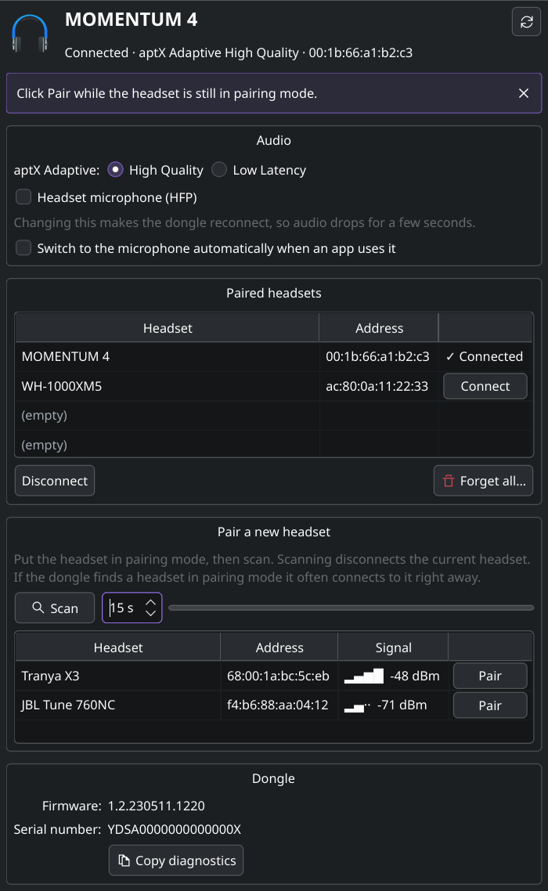

# btwctl - control the Creative BT-W5 and BT-W6 Bluetooth audio dongles on Linux

[](https://github.com/doodersrage/btwctl/actions/workflows/test.yml)

Creative only makes its app for the BT-W5 (and BT-W6) for Windows and macOS. This does the same on Linux:
switch aptX Adaptive between High Quality and Low Latency, turn the headset microphone (HFP) on or off,
pair new headsets and switch between paired ones, and get a notification when a headset connects.

It comes with a settings window, a system tray icon, a command line tool and a status bar module.

*btwctl was called **btw5-switch** until version 0.7; see [Upgrading from btw5-switch](#upgrading-from-btw5-switch).*



## What you need

- A Creative BT-W5 (USB ID `041e:3130`) or BT-W6 (`041e:3132`) dongle; see [Supported dongles](#supported-dongles). Check with `lsusb | grep -i creative`.
- Linux with Python 3.9 or newer.
- For the window and tray icon: PyQt6 or PySide6. The install steps below include it.

Sound works without this tool: the dongle is a standard USB sound card, and volume is controlled from your desktop as usual.
This tool is for the dongle's settings and pairing.

## Install

### Arch Linux and derivatives (Manjaro, EndeavourOS, CachyOS)

Download `btwctl-…-any.pkg.tar.zst` from the [latest release](https://github.com/doodersrage/btwctl/releases/latest), then:

```sh
sudo pacman -S --needed python-pyqt6        # for the window and tray icon
sudo pacman -U ./btwctl-*-any.pkg.tar.zst
```

Or build it from source:

```sh
sudo pacman -S --needed base-devel git python-pyqt6
git clone https://github.com/doodersrage/btwctl
cd btwctl
makepkg -si
```

Then **unplug the dongle and plug it back in**, so your user gets access to it.

### Debian, Ubuntu, Linux Mint, Pop!_OS

Download `btwctl_…_all.deb` from the [latest release](https://github.com/doodersrage/btwctl/releases/latest), then:

```sh
sudo apt install ./btwctl_*_all.deb
```

### Fedora

Download `btwctl-….noarch.rpm` from the [latest release](https://github.com/doodersrage/btwctl/releases/latest), then:

```sh
sudo dnf install ./btwctl-*.noarch.rpm
```

### Other distributions (or the latest code)

```sh
# Debian/Ubuntu: sudo apt install git pipx libusb-1.0-0
# Fedora:        sudo dnf install git pipx libusb1
# others:        install git, pipx and libusb 1.0 with your package manager
git clone https://github.com/doodersrage/btwctl
cd btwctl
sudo ./install.sh
```

`install.sh` puts the program in `/opt/btwctl` (with the `btwctl` command in `/usr/local/bin`) and adds the device access rule, app menu entries and shell completions.
It downloads PyUSB and PyQt6 for the window; add `--no-gui` if you only want the command line tool.

Then **unplug the dongle and plug it back in**, so your user gets access to it.

## Getting started

Open **BT-W Control** from your application menu, or run `btwctl gui`.
You'll see the connected headset, its aptX mode and your paired headsets. Everything else is a click away.

From a terminal, `btwctl status` shows the same:

```
$ btwctl status
Headset            : MOMENTUM 4 (00:1b:66:a1:b2:c3)
aptX Adaptive mode : High Quality
HFP (headset mic)  : off
Auto HFP switching : off
```

If that prints an error instead, see [Troubleshooting](#troubleshooting).

### Pairing a new headset

1. Put the headset in pairing mode (usually: hold the power or Bluetooth button until the light flashes).
2. In the window, click **Scan** (or run `btwctl scan`). This disconnects the current headset.
3. Click **Pair** next to your headset (or run `btwctl pair <address>`) while it's still in pairing mode.

Often the dongle doesn't even list the headset but connects to it straight away; the window then says so.
The dongle remembers up to 4 headsets. To switch to another one later, click **Connect** next to it, or run `btwctl pair <name>`.

### Tray icon

The tray icon shows the headset and settings when you hover over it. Left click switches between Low Latency and High Quality; its menu has the other settings, your paired headsets, and **Open BT-W Control…**.

Start it with **BT-W Control (tray icon)** from the application menu, or `btwctl tray`. To start it automatically when you log in:

```sh
mkdir -p ~/.config/autostart
cp /usr/share/applications/btwctl-tray.desktop ~/.config/autostart/
```

- **KDE Plasma** may put new icons behind the ▲ arrow in the panel. To keep it visible: right-click the arrow → *Configure System Tray…* → *Entries* → set "btwctl" to *Always shown*.
- **GNOME** has no tray of its own. Install the *AppIndicator and KStatusNotifierItem Support* extension (Ubuntu has it already), or use the window instead.

### Notifications

```sh
systemctl --user enable --now btwctl-monitor.service
```

shows a desktop notification whenever a headset connects or disconnects or a setting changes.
This background service is also what applies per-headset settings and game mode (below); the window shows whether it's running and has a button to start it.

### Per-headset settings

Tick **Use these settings whenever MOMENTUM 4 connects** in the window, and the current aptX mode, microphone and auto-switching settings are applied every time that headset connects (handy if you switch between headsets, or the dongle forgets).
From a terminal:

```sh
btwctl prefer momentum --aptx hq --hfp off   # set some
btwctl prefer current --current              # remember the connected headset's current settings
btwctl prefer                                # list them
btwctl prefer momentum --clear               # forget them
```

### Game mode

With game mode on, the dongle switches to **aptX Low Latency** while a game is running and back to the previous mode when you quit.
Turn it on in the window (**Automation**), the tray menu, or with `btwctl game-mode on`.

A program counts as a game if its command line contains one of the listed words. By default these cover Steam games (native and Proton), gamescope, Lutris and Heroic.
Add your own with `btwctl game-mode add minecraft` or in the window. `btwctl game-mode` shows the list and which ones are running right now.

### Sound follows the headset

The dongle stays a sound card even when no headset is connected, so sound sent to it then goes nowhere.
With **Switch sound to the dongle while a headset is connected** (window → Automation, the tray menu, or `btwctl audio-follow on`), the dongle becomes your default output when a headset connects, and your previous output (speakers, another headset) comes back when it disconnects. With the headset microphone (HFP) on, the microphone follows too.
If you pick a different output yourself in the meantime, that choice is left alone. This uses PipeWire (`wpctl`), the default on current desktops.

### Keyboard shortcuts and quick actions

Right-click **BT-W Control** in the application menu for Low Latency, High Quality and Toggle.
For a keyboard shortcut, add a custom shortcut that runs `btwctl --notify toggle` (or `ll` / `hq`):
- **KDE Plasma**: *System Settings → Keyboard → Shortcuts → Add New → Command or Script*
- **GNOME**: *Settings → Keyboard → View and Customize Shortcuts → Custom Shortcuts*

`--notify` shows the result as a notification, since a shortcut has no terminal to print to.

## Command line

```
btwctl status              # connected headset, aptX mode, HFP and auto-HFP settings
btwctl ll | hq             # aptX Adaptive Low Latency / High Quality
btwctl toggle              # switch between the two
btwctl hfp on|off          # headset microphone (HFP); audio drops for a few seconds
btwctl auto-hfp on|off     # switch to the microphone automatically when an app uses it
btwctl paired              # list the 4 pairing slots
btwctl pair momentum       # connect to a paired headset by (part of) its name
btwctl scan [seconds]      # disconnect the headset and list nearby headsets (default 15 s)
btwctl pair 68:00:1a:bc:5c:eb   # connect to an address shown by 'scan'
btwctl disconnect          # disconnect the current headset
btwctl forget              # forget all paired headsets (asks first; -y to skip)
btwctl info                # firmware version and serial number
btwctl prefer [headset] [--aptx hq|ll] [--hfp on|off] [--auto-hfp on|off]
                                # settings to apply whenever that headset connects
btwctl game-mode [on|off|add|remove]   # Low Latency while a game runs
btwctl audio-follow [on|off]    # default audio device follows the headset
btwctl gui                 # settings window
btwctl tray                # system tray icon
btwctl monitor [--notify]  # print (and notify about) headset and setting changes
btwctl waybar              # status as JSON for a status bar
btwctl dump                # every readable register (for bug reports)
btwctl -v <command>        # also show the raw USB traffic
btwctl --notify <command>  # show the result as a desktop notification
btwctl --device 041e:XXXX <command>    # try another Creative dongle (see Supported dongles)
```

`status`, `info`, `paired`, `scan` and `dump` take `--json`. Tab completion works in bash, zsh and fish, including headset names for `pair`.

### Status bar

`btwctl waybar` prints `{"text": "MOMENTUM 4 · HQ", "class": "connected", "tooltip": ...}` for a waybar or polybar module.
See [`contrib/waybar/`](contrib/waybar/) for a waybar module that toggles the aptX mode on click, and [`contrib/polybar.ini`](contrib/polybar.ini) for polybar.

## Troubleshooting

**"No Creative BT-W5 or BT-W6 found"**
: The dongle isn't plugged in, or is restarting: it disappears for a few seconds after changing HFP or forgetting headsets. Check with `lsusb -d 041e:3130`.

**"Permission denied accessing the dongle"**
: Unplug the dongle and plug it back in. If that doesn't help, the access rule isn't installed: check that `/usr/lib/udev/rules.d/70-btwctl.rules` exists (if not, run `makepkg -si` or `sudo ./install.sh` again), then run `sudo udevadm control --reload-rules` and re-plug.
The rule gives access to whoever is logged in at the computer; over SSH, use `sudo btwctl ...`.

**"The dongle is in use by another program"**
: Another program holds the dongle. Usually that's Creative's app in a Windows VM with USB passthrough, or an old `btwctl` that's stuck (`pkill -f btwctl`).

**aptX Adaptive mode shows "not available"**
: The connected headset doesn't use aptX Adaptive (for example it only supports SBC or AAC), or no headset is connected. The mode switch only works with aptX Adaptive headsets.

**"The dongle refused to connect" (status 0x80)**
: The dongle can't reach the headset. Turn the headset on, make sure it isn't connected to your phone or another computer, or put it in pairing mode and scan again.

**The window or tray says it needs PyQt6 or PySide6**
: Arch: `sudo pacman -S python-pyqt6`. Other distributions: run `sudo ./install.sh` again (without `--no-gui`).

**No tray icon**
: See the KDE and GNOME notes under [Tray icon](#tray-icon).

**Game mode or per-headset settings don't do anything**
: They're applied by the background service: check that it runs (`systemctl --user status btwctl-monitor.service`, or look at the Automation section in the window).
For game mode, run `btwctl game-mode` while the game is running: if it says "Running now: none", add a word from the game's command line (see `ps aux`) with `btwctl game-mode add <word>`.

**Something else**
: Run the command with `-v` (for example `btwctl -v status`) and [open an issue](https://github.com/doodersrage/btwctl/issues) with the output and the output of `btwctl dump`. In the window, **Copy diagnostics** copies the same information.

## Updating and uninstalling

Update:
- Release packages (`.pkg.tar.zst`, `.deb`, `.rpm`): install the new package from the [latest release](https://github.com/doodersrage/btwctl/releases/latest) the same way.
- From source: in the `btwctl` folder, run `git pull`, then `makepkg -si` (Arch) or `sudo ./install.sh`.

Uninstall: `sudo apt remove btwctl`, `sudo dnf remove btwctl` or `sudo pacman -R btwctl`; for `install.sh`, run `sudo ./install.sh --uninstall` in the `btwctl` folder.
Your settings are in `~/.config/btwctl/`.

Either way, also remove `~/.config/autostart/btwctl-tray.desktop` if you set up the tray to start at login, and run `systemctl --user disable --now btwctl-monitor.service` if you enabled notifications.

### Upgrading from btw5-switch

Version 0.7 renamed btw5-switch to **btwctl**, since it now supports more than the BT-W5. Install btwctl like any update: the `.deb`, `.rpm` and Arch packages replace btw5-switch, and `install.sh` removes the old install. Nothing else is required:

- `btw5-switch` still works as a command, so scripts, shortcuts and status bar modules keep running.
- Your settings move to `~/.config/btwctl/` automatically.
- A background service you enabled as `btw5-switch-monitor.service` keeps working. **Start background service** in the window switches it to the new name, or run:
  `systemctl --user disable --now btw5-switch-monitor.service && systemctl --user enable --now btwctl-monitor.service`
- If the tray starts at login, it keeps working too. To use the new launcher name:
  `rm ~/.config/autostart/btw5-switch-tray.desktop && cp /usr/share/applications/btwctl-tray.desktop ~/.config/autostart/`

## Supported dongles

| Dongle | USB ID | Status |
|---|---|---|
| Creative BT-W5 | `041e:3130` | Everything tested on real hardware (see [Status](#status)) |
| Creative BT-W6 | `041e:3132` | aptX Low Latency / High Quality switching [reported to work](https://gist.github.com/RaphaelWimmer/0d0aab0bb361f6ca721de1896bc26876?permalink_comment_id=5351536) by a user. It speaks the same protocol, so the rest is expected to work too, but hasn't been confirmed |
| Other Creative BT-W dongles (BT-W3, BT-W4, …) | ? | Unknown; see below |

Both supported dongles are found automatically. **BT-W6 owners:** please [report](https://github.com/doodersrage/btwctl/issues/new/choose) what works, ideally with the output of `btwctl dump`.

Other Creative BT-W dongles may speak the same protocol. If `btwctl` finds one, it says so; try it with `btwctl --device 041e:XXXX status` (the USB ID is in `lsusb | grep -i creative`). `dump` is read-only and safe.
Please [open an issue](https://github.com/doodersrage/btwctl/issues/new/choose) ("Another Creative dongle") with what you find.

## How it works

### Creative BT-W5

The Creative BT-W5 is a USB Bluetooth audio dongle.
It is *not* a normal Bluetooth dongle, i.e. it cannot be used for connecting to non-audio devices.
Instead, it acts as an USB audio device towards the computer and as Bluetooth host towards wireless headsets.

### Sharing the dongle

Only one program can open the dongle's control interface at a time.
While `btwctl monitor` runs (for example as the notification service), it shares the dongle over a Unix socket (`$XDG_RUNTIME_DIR/btwctl.sock`), and all other `btwctl` commands, the window, the tray and the status bar module go through it automatically.
Short-lived commands that find the dongle busy wait up to 3 seconds for it.

### Protocol

The BT-W5 appears as a USB sound card (interfaces 2-4, no driver needed) plus two HID interfaces.
Configuration goes through HID interface 0. The tool sends output report 3 as a `SET_REPORT` control transfer, and replies come back as input report 3 on interrupt endpoint `0x81`.
The interface's report descriptor doesn't declare input report 3, so the kernel drops the replies and `/dev/hidraw` can't be used; the tool talks to the interface directly with PyUSB.
The communication between the Creative app on Windows and the dongle was logged with [Wireshark](https://www.wireshark.org/) and [USBPcap](https://github.com/desowin/usbpcap) and annotated: [bt-w5.pcapng](bt-w5.pcapng).

Every report is `03 5a <cmd> <len> <payload>`, zero-padded to 65 bytes.

| Command (cmd payload) | Meaning | Reply |
|---|---|---|
| `6b 0a 03 20` / `6b 0a 03 40` | aptX Adaptive LL / HQ | ack `02 0a 6b 00 0a 03 <val>`, `6b 09 08 <val>` |
| `6b 0a 01 01` / `6b 0a 01 02` | HFP on / off | ack, then USB re-enumeration |
| `6b 0a 02 01` / `6b 0a 02 00` | auto-HFP on / off | ack, `6b 09 07 <val>` |
| `6b 09 <key>` | read setting: `03` aptX, `06` HFP, `07` auto-HFP, `08` active aptX mode | `6b 09 <key> <val>` |
| `6b 04 01` | disconnect and scan | `6b 05 <addr6> <nlen> <name> <rssi int16 LE>` per device, or `6b 06` connection events if it connects to a headset in pairing mode by itself |
| `6b 04 02 <addr6>` | connect to address | ack (status `80` if the headset can't be reached), then `6b 06 08`/`0b` |
| `6b 06` | current connection | `6b 06 <state> <addr6> 20 <name[32]>`; no reply right after a scan disconnect |
| `6b 02 <slot>` | read pairing slot 0-3 | `6b 02 <slot> 80 <addr6> 1f <name[31]>` (`00` instead of `80` past the last slot) |
| `6b 07 ff` | forget all pairings | USB re-enumeration |
| `09 02` / `09 03` | firmware version / serial | `09 <field> <ascii>` |

Acks look like `02 0a <cmd> <status> <echo>`, where the echo repeats the start of the request (all of `0a <key> <val>` for settings). Status `00` means OK, `80` means rejected right now (for example `6b 09 03` with no aptX Adaptive headset connected), `81` means unknown command.

Connection states in `6b 06` frames: `06` not connected (known headset out of reach), `08` connecting, `0a` disconnected, `0b` connected.
They also arrive unprompted when the link changes, as do setting changes (`6b 09 <key> <val>`).

Seen but not yet understood (values on firmware 1.2.230511.1220; none of them changed with aptX mode, volume or connection state):
`6b 09 00` → `01`, `6b 09 01` → `04`, `6b 09 02` → `75`, `6b 09 04` → `3c b3 6e 3d 00 02`, `6b 09 05` → `03`, `6b 01` → `01 01`,
`09 00` → `2b 31 01 01 1e 04` (`041e` is Creative's vendor ID), `09 01 00` → `00 90 ad 3a 21 3c 04`, and the event `6b 06 07` after a scan starts or pairings are forgotten.
The app also sends `07 01 02`, `10`, `26 01 05`, `2c 01 02` and `39 01 02`, which this dongle rejects with status `81` (probably meant for other Creative devices).
`btwctl dump` prints all of these, so if you have a different firmware or headset, its output is very welcome in an issue.


## Development

```sh
python -m pytest            # protocol parsers against the capture, a fake dongle for the CLI and window
python -m btwctl status     # run from the checkout without installing
python docs/screenshot.py docs/window.png   # regenerate the README screenshot
```

Code layout: `btwctl/protocol.py` (frames and parsers), `btwctl/device.py` (USB access, requests), `btwctl/broker.py` (sharing the dongle), `btwctl/automation.py`, `btwctl/audio.py` and `btwctl/config.py` (per-headset settings, game mode, sound follows the headset), `btwctl/cli.py`, `btwctl/window.py` and `btwctl/tray.py` (sharing `btwctl/qt.py`).
`aur/` holds the release PKGBUILD, `packaging/` builds the `.deb` and `.rpm`, `debian/` and `.copr/` are for an Ubuntu PPA and Fedora COPR ([how to publish](packaging/PUBLISHING.md)).
To release: update `CHANGELOG.md` and `btwctl/__init__.py`, then push a tag like `v0.6`; GitHub Actions builds the packages and publishes the release.

## Status

Tested on real hardware (firmware 1.2.230511.1220, Sennheiser MOMENTUM 4): `status`, `info`, `dump`, `paired`, aptX switching, `hfp`, `auto-hfp`, `disconnect`, `monitor` (including following the dongle through HFP re-enumeration and sharing it with other commands), `waybar`, the tray and the settings window.
Scanning and pairing a headset from the window have been confirmed on hardware too. Not yet confirmed on hardware: `forget`, per-headset settings and game mode (tested against a simulated dongle).
The install steps for Ubuntu and Fedora are run automatically on every change (see the tests badge).

Based on [RaphaelWimmer/btw5-switch](https://github.com/RaphaelWimmer/btw5-switch). Pull requests welcome.

## License

The code is released under the [MIT License](LICENSE).
The USB capture (`bt-w5.pcapng`), its screenshot (`btw5-wireshark.png`) and the original protocol notes are Raphael Wimmer's work from the upstream repository, which doesn't state a license yet.
